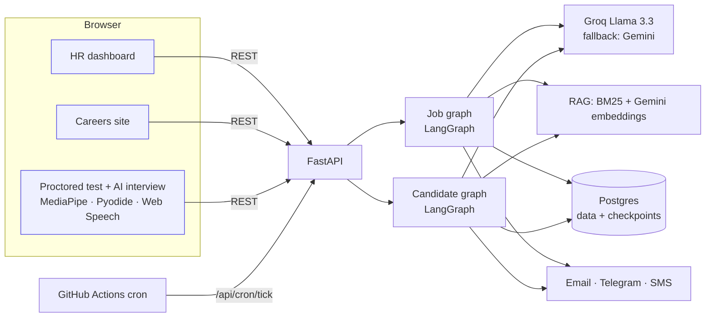

# 🧭 TalentPilot: Agentic AI Recruitment Automation

> HR types **"Hire a backend engineer"**. AI agents write the JD from company policy (RAG), post it,
> **replan** the posting if applications are weak, screen resumes, run an **AI-proctored coding test**,
> conduct an **AI voice interview**, and draft the offer letter. Every important decision waits for a
> human approval, and the system **learns** from HR feedback.

Built with **LangGraph** (durable multi-agent workflows with human-in-the-loop), **LangChain**, **RAG**,
**FastAPI**, **React**, and **MediaPipe** in-browser computer vision. Every service it uses has a **free tier**.

---

## ✨ Features

| Stage | What the agents do | Human in the loop |
|---|---|---|
| 1. Hiring request | Parse "Hire a backend engineer, 3-5 yrs" into a structured request | HR types the request |
| 2. JD generation | **RAG** over salary bands, hiring policy, benefits, tech stack and past JDs, then a policy-compliant JD with citations | ⏸ HR approves, asks AI for changes, or edits |
| 3. Multi-platform posting | Careers site (live), Telegram channel (live), LinkedIn post + one-click share, Naukri-formatted listing | |
| 4. Deadline + **replanning** | When the window closes, evaluate the pipeline. Too few qualified applicants → diagnose and rewrite (e.g. *Backend → Full Stack*, relax experience, remote) → repost | ⏸ HR approves the replan |
| 5. Resume screening | Parse resume → **hybrid score**: LLM rubric 45% + must-have skills 25% + semantic similarity 15% + experience fit 15%. Identity details are anonymised before scoring | |
| 6. Shortlist | Top-N shortlisted, rest waitlisted (auto-promoted if someone drops), the others get a polite rejection | |
| 7. Online assessment | AI-generated MCQs + Python coding problem (**tests verified against a reference solution**). Code runs in the browser via Pyodide | |
| 8. **AI proctoring** | Face missing, multiple people, looking away, **phone detection**, talking, tab switch, fullscreen exit, large paste, devtools, plus webcam snapshots → integrity score, streamed live to HR | Flags are evidence for HR, never an auto-reject |
| 9. **AI interview** | Adaptive voice interview (speech-to-text + text-to-speech in the browser), then a rubric evaluation | |
| 10. Final report | Combines resume, test, integrity and interview into a recommendation | ⏸ HR approves or rejects the candidate |
| 11. Offer | RAG on salary band + policy → offer within band (guardrail) → PDF letter | ⏸ HR edits/approves before sending |
| 12. Candidate response | Accept/decline link. Decline → next waitlisted candidate is promoted automatically | |
| 13. **Learning** | Every HR edit, rejection and override is stored and injected into future prompts | HR can add or remove rules |

Notifications go out by **email** (Brevo), **Telegram** (HR alerts + job channel) and optional **SMS** (Twilio).

---

## 🏗️ Architecture



**Job graph** (one per job):
`draft_jd → ⏸review_jd → publish → ⏸wait_deadline → evaluate → (replan → ⏸review_replan → apply_replan → publish …) | screen`

**Candidate graph** (one per shortlisted candidate):
`invite_assessment → ⏸wait_assessment → grade → invite_interview → ⏸wait_interview → grade → final_report → ⏸hr_decision → draft_offer → ⏸offer_review → send_offer → ⏸wait_response → hired | declined → promote next`

⏸ = LangGraph `interrupt()`. The workflow is **checkpointed in Postgres** and can wait days for HR or
the candidate. It survives server restarts and free-tier sleep, and resumes on a button click or a scheduler tick.
Failed steps can be retried from the UI (only the failed node re-runs).

### Project structure
```
talentpilot/
├── backend/
│   ├── app/
│   │   ├── agents/
│   │   │   ├── job_graph.py        # JD → post → replan → screen workflow
│   │   │   ├── candidate_graph.py  # test → interview → offer workflow
│   │   │   ├── skills.py           # all LLM "skills" (JD writer, screener, replanner, interviewer...)
│   │   │   ├── schemas.py          # Pydantic structured outputs
│   │   │   └── runtime.py          # checkpointer, background runs, retry, crash recovery
│   │   ├── routers/                # hr.py, public.py, candidate.py
│   │   ├── rag.py                  # chunking, BM25 + embeddings, Reciprocal Rank Fusion
│   │   ├── llm.py                  # Groq + Gemini with fallback, offline fake mode
│   │   ├── notify.py               # Brevo/SMTP email, Telegram, Twilio SMS
│   │   ├── scheduler.py            # deadlines & expiries
│   │   ├── documents.py            # resume parsing, offer-letter PDF
│   │   ├── check.py                # `python -m app.check` setup checker
│   │   └── seed/                   # sample company handbook for RAG
│   └── tests/test_flow.py          # full lifecycle end-to-end test
├── frontend/src/
│   ├── pages/hr/                   # dashboard, job detail, candidate, knowledge, learning
│   ├── pages/public/               # careers + apply
│   ├── pages/candidate/            # assessment, interview, offer
│   └── proctor/                    # useProctor (MediaPipe), Pyodide worker
├── samples/                        # demo resumes (strong / medium / weak / fresher)
├── Dockerfile · render.yaml · .github/workflows/tick.yml
```

---

## 🆓 Tech stack (all free)

| Need | Service | Free tier |
|---|---|---|
| LLM (primary) | Groq: `llama-3.3-70b-versatile`, `llama-3.1-8b-instant` | Free API key, rate-limited |
| LLM fallback + embeddings | Google Gemini API (AI Studio) | Free tier |
| Agents | LangGraph + LangChain | Open source |
| Database + checkpoints | Neon Postgres | Free 0.5 GB |
| Hosting (API + UI in one container) | Render web service (Docker) | Free (sleeps after 15 min idle) |
| Scheduler wake-up | GitHub Actions cron | Free |
| Email | Brevo | 300 emails/day |
| Alerts + job channel | Telegram Bot API | Free |
| Proctoring vision | MediaPipe Tasks (runs in the browser) | Free |
| Code execution | Pyodide (Python in WebAssembly) | Free |
| Voice | Web Speech API (Chrome/Edge) | Free |
| Tracing (optional) | LangSmith | Free developer tier |

---

## 🚀 Run locally

Prerequisites: **Python 3.11+**, **Node 20+**, Git.

```bash
# 1. Backend
cd backend
python -m venv .venv
.venv\Scripts\activate            # Windows   (macOS/Linux: source .venv/bin/activate)
pip install -r requirements-dev.txt
copy .env.example .env            # macOS/Linux: cp .env.example .env  → then paste your keys
python -m app.check               # verifies DB + LLM keys
uvicorn app.main:app --reload --port 8000

# 2. Frontend (new terminal)
cd frontend
npm install
npm run dev                       # http://localhost:5173  (proxies /api to :8000)
```

Open **http://localhost:5173/hr** and log in with `ADMIN_EMAIL` / `ADMIN_PASSWORD` from `.env`
(default `hr@example.com` / `admin123`).

- No API key yet? Set `LLM_PROVIDER=fake` to click through the whole workflow with placeholder AI output.
- Tests: `cd backend && pytest -q` (runs the entire hire-to-offer lifecycle offline).

---

## 🔑 Accounts & API keys (all free, about 30 minutes)

| # | Service | Steps | Put in `.env` |
|---|---|---|---|
| 1 | **Groq** | [console.groq.com](https://console.groq.com) → sign in with Google → **API Keys** → *Create API Key* | `GROQ_API_KEY` |
| 2 | **Google AI Studio** | [aistudio.google.com/apikey](https://aistudio.google.com/apikey) → *Create API key* | `GEMINI_API_KEY` |
| 3 | **Neon** | [neon.tech](https://neon.tech) → sign up → *Create project* (pick the region closest to you, e.g. Singapore) → **Connect** → copy the connection string | `DATABASE_URL` |
| 4 | **Brevo** | [brevo.com](https://www.brevo.com) → sign up → **Senders, domains & dedicated IPs → Senders** → add & verify your Gmail → **SMTP & API → API keys** → *Generate* | `EMAIL_PROVIDER=brevo`, `BREVO_API_KEY`, `EMAIL_FROM` (the verified email) |
| 5 | **Telegram** (optional) | Open **@BotFather** → `/newbot` → copy token. Send any message to your bot, then open `https://api.telegram.org/bot<TOKEN>/getUpdates` and copy `chat.id`. For job posting: create a public channel, add the bot as **admin** | `TELEGRAM_BOT_TOKEN`, `TELEGRAM_HR_CHAT_ID`, `TELEGRAM_CHANNEL_ID=@yourchannel` |
| 6 | **GitHub** | [github.com](https://github.com) → New repository → push this project | |
| 7 | **Render** | [render.com](https://render.com) → sign in with GitHub (see deploy steps below) | |
| 8 | LangSmith (optional) | [smith.langchain.com](https://smith.langchain.com) → Settings → API Keys | `LANGSMITH_TRACING=true`, `LANGSMITH_API_KEY` |
| 9 | Twilio (optional) | [twilio.com/try-twilio](https://www.twilio.com/try-twilio) → trial number. Trial SMS only reaches **verified** numbers | `TWILIO_*` |

> Model names change over time. If Groq says a model is decommissioned, pick a current one from
> [console.groq.com/docs/models](https://console.groq.com/docs/models) and update `GROQ_MODEL_SMART` / `GROQ_MODEL_FAST`.

---

## ☁️ Deploy (Render + Neon, free)

1. **Push to GitHub**
   ```bash
   cd talentpilot
   git init && git add . && git commit -m "TalentPilot"
   git branch -M main
   git remote add origin https://github.com/<you>/talentpilot.git
   git push -u origin main
   ```
2. **Render** → **New → Blueprint** → select the repo. `render.yaml` creates a free Docker web service.
   Fill in the secret values it asks for:
   - `DATABASE_URL`: Neon connection string
   - `GROQ_API_KEY`, `GEMINI_API_KEY`
   - `ADMIN_EMAIL`, `ADMIN_PASSWORD`: your HR login
   - `BREVO_API_KEY`, `EMAIL_FROM`, `HR_NOTIFY_EMAIL`
   - `PUBLIC_URL`: leave a placeholder for now
3. After the first deploy, copy your URL (e.g. `https://talentpilot-xxxx.onrender.com`), set
   **`PUBLIC_URL`** to it in Render → Environment, and save (Render redeploys automatically).
4. **Scheduler**: GitHub repo → Settings → Secrets and variables → Actions → add
   `APP_URL` (your Render URL) and `CRON_SECRET` (copy it from Render → Environment).
   The workflow `.github/workflows/tick.yml` calls the app every 10 minutes so deadlines fire
   even while the free instance sleeps. ([cron-job.org](https://cron-job.org) works too: GET
   `https://<app>/api/cron/tick?secret=<CRON_SECRET>`.)
5. Open `https://<app>/hr` → log in → **Settings** page shows which integrations are connected.

**Free tier notes**
- Render free instances sleep after 15 minutes idle; the first request then takes ~50 s. Open the site a minute before a demo.
- Workflows waiting for approval live in Postgres, so sleep and restarts are safe.
- Camera and microphone need **HTTPS** (Render gives it) or `localhost`.
- Free hosts often block outbound SMTP ports, which is why email defaults to Brevo's HTTPS API (no SMTP needed).

---

## 🎬 Demo script (about 8 minutes)

1. **Knowledge base**: show company docs and test retrieval ("salary band senior backend").
2. **New hiring request**: "Hire a backend engineer with Python and PostgreSQL, 3-5 years", window **3 minutes (demo)**, min applications **5**.
3. JD appears with **RAG citations** → click *Ask AI for changes* ("add Kafka") → approve.
4. Show **Postings**: careers page live, LinkedIn share, Naukri text, Telegram channel post.
5. Apply from the careers page with 2 sample resumes from `samples/` (fewer than 5).
6. Deadline passes → **Replan proposal** (e.g. Backend → Full Stack, remote) → approve → reposted.
7. Apply with the remaining resumes → *Close applications & screen now* → ranked shortlist with score breakdown.
8. Open the candidate's email link → **proctored test** (show phone detection / tab switch warnings) → submit.
9. HR candidate page → **Proctoring tab** with live events and snapshots.
10. **AI voice interview** → final report → HR approves → edit CTC → offer email → candidate **accepts**.
11. **Learning memory** shows what the system learned from your edits.

---

## 🧪 Testing

```bash
cd backend
pytest -q                                              # SQLite
TEST_DATABASE_URL=postgresql://user:pw@host/db pytest -q   # Postgres
```
The end-to-end test drives the real API and LangGraph workflows (fake LLM): JD revision → publish →
applications → replan → repost → screening → proctored assessment → interview → HR approval → offer edit → acceptance → job filled → learning memory.

---

## 🛡️ Responsible AI

- Resumes are **anonymised** (name, email, phone, links removed) before LLM scoring, and the prompts ignore gender, age and college.
- **Proctoring never auto-rejects.** It produces evidence (events + snapshots) for a human.
- **A human must approve** the JD, any replan, the hire decision and the offer.
- Offer CTC is clamped to the approved salary band (guardrail).
- Candidates give explicit consent for AI processing and camera monitoring.

## ⚠️ Known limitations

- **LinkedIn / Naukri** posting APIs are partner-only, so the app generates ready-to-post content plus a one-click LinkedIn share. Each channel is behind a small adapter, so a real API can be plugged in later.
- Coding tests run **in the candidate's browser** (Pyodide). The reported pass count is cross-checked by an LLM code review; a server sandbox (e.g. Judge0) would make it tamper-proof.
- Browser speech recognition works best in Chrome/Edge; candidates can always type.
- Free LLM tiers have rate limits. The app retries and falls back from Groq to Gemini automatically.

## 🔭 Future scope

Calendar scheduling for human interview rounds, Judge0 sandbox, WhatsApp Business notifications,
multi-tenant companies & roles, bias analytics dashboard, fine-tuned resume ranker.
